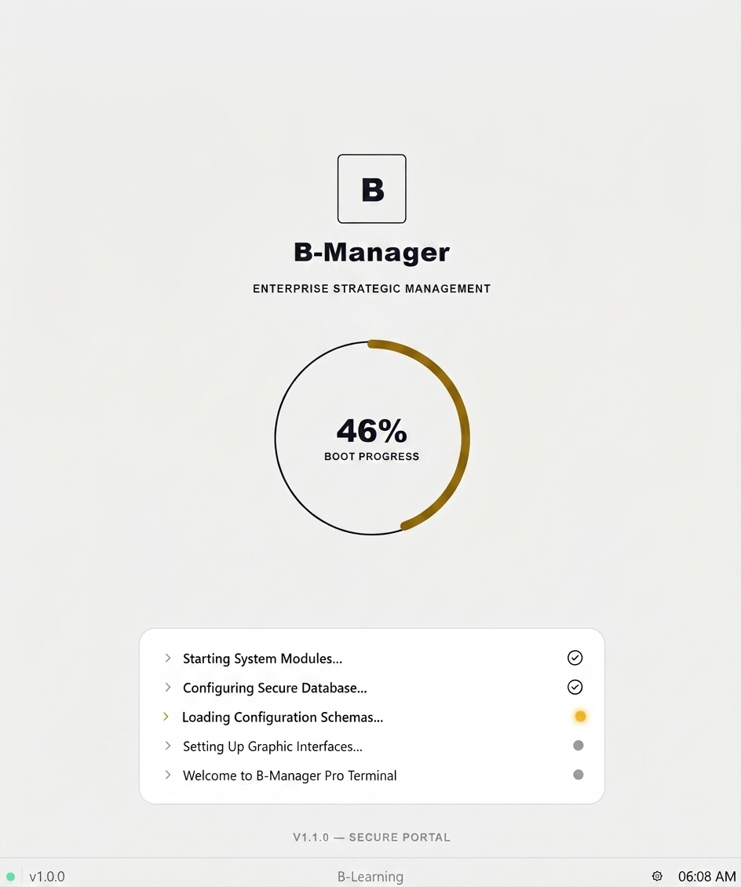
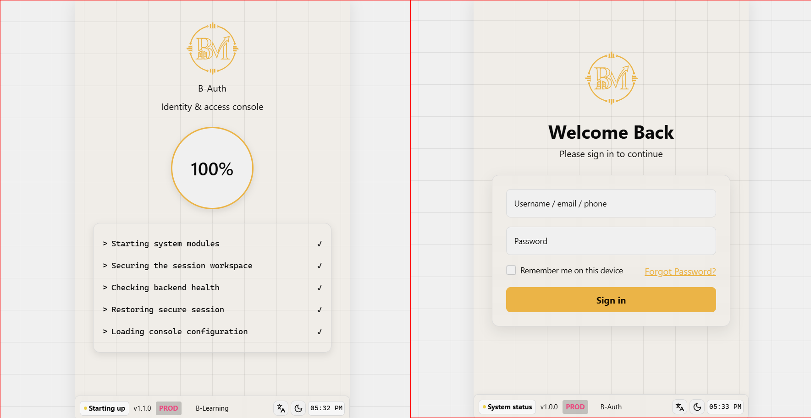

# B-Auth

B-Auth هو نظام مصادقة وإدارة صلاحيات مبني كـ monorepo، وبيوفر تدفق تسجيل دخول وتسجيل مستخدمين وإدارة جلسات وأدوار وصلاحيات، مع واجهة عربية/إنجليزية ودعم RTL/LTR والثيم الداكن.

## ملخص المشروع

المشروع مقسوم إلى واجهة Frontend وخادم Backend:

- شاشة إقلاع وفحص جاهزية التشغيل.
- تسجيل الدخول باسم المستخدم أو البريد الإلكتروني.
- إنشاء حساب جديد عند تفعيل الميزة.
- جلسات آمنة باستخدام access token في الذاكرة وrefresh token داخل HttpOnly cookie.
- أدوار وصلاحيات للمستخدمين.
- شاشة Home محمية من الوصول بدون جلسة.
- رسائل أخطاء مترجمة ودعم RTL/LTR.

### صور شاشات النظام






> مرجع بصري لشاشة تسجيل الدخول: تخطيط split-screen، لون ذهبي للهوية، خلفية grid، وكارت دخول بسيط. الصورة محفوظة داخل `docs/references/images/auth-login-reference.png` ومصدرها [رابط الصورة الأصلي](https://hebbkx1anhila5yf.public.blob.vercel-storage.com/image-ZwzojLo9fzJPnKv55RJxfFt7TQjTwh.png).

## التقنيات المستخدمة

- Frontend: Vite 6، React 19، TypeScript، Tailwind CSS 4.
- Backend: Node.js 20+، Express، TypeScript.
- الحالة: Zustand، مع حفظ اسم المستخدم المتذكَّر فقط.
- الترجمة: i18next وreact-i18next للغتين العربية والإنجليزية.
- الشبكة: Axios مع Callback Injection.
- التحقق: Zod.
- الأمان: Helmet، CORS، rate limiting، bcryptjs، JWT، HttpOnly cookies.
- الاختبارات: Vitest.
- التخزين الحالي: JSON repositories للتطوير، مع خدمة S3-compatible اختيارية للملفات.
- إدارة الحزم: pnpm workspaces.

## البدء

المتطلبات:

- Node.js 20 أو أحدث.
- pnpm.

ثبّت الاعتماديات:

```bash
pnpm install --frozen-lockfile
```

شغّل الواجهة والخادم معاً:

```bash
pnpm dev
```

أوامر مفيدة:

```bash
pnpm typecheck
pnpm lint
pnpm test
pnpm build
```

الخادم يعمل افتراضياً على المنفذ `4000`، وواجهة Vite تعمل افتراضياً على المنفذ `3000`.

## الاستخدام

1. شغّل المشروع باستخدام `pnpm dev`.
2. افتح واجهة Frontend من عنوان Vite الظاهر في الطرفية.
3. استخدم بيانات المستخدم المهيأة في بيئة التطوير أو أنشئ حساباً جديداً إذا كانت ميزة التسجيل مفعلة.
4. بعد تسجيل الدخول، تظهر شاشة Home حسب الدور والصلاحيات.
5. استخدم زر اللغة لتبديل العربية والإنجليزية، وزر الثيم لتبديل الوضع الفاتح والداكن.

للتفاصيل المعمارية وسجل الجلسات، راجع:

- `docs/AI_CONTEXT.md`
- `docs/AI_SESSION.md`
- `docs/TODO.md`
- `docs/CHANGELOG.md`

## الترخيص

لم يتم اعتماد ترخيص مفتوح المصدر للمشروع حتى الآن. كل الحقوق محفوظة للمالك إلى أن يتم إضافة ملف ترخيص رسمي.

## المساهمة

المساهمة مرحب بها بعد الاتفاق على نطاق التغيير:

1. راجع ملفات التوثيق داخل `docs/` قبل التعديل.
2. حافظ على فصل Frontend وBackend وقواعد الاستيراد المركزية.
3. أضف أو حدّث الاختبارات الخاصة بأي سلوك جديد.
4. شغّل `pnpm typecheck` و`pnpm lint` و`pnpm test` و`pnpm build` قبل تقديم التغيير.
5. اكتب وصفاً واضحاً للتغيير بالعربية المصرية في الـ commit أو Pull Request حسب قواعد المستودع.

## الاتصال

للاستفسارات أو طلبات المساهمة، استخدم Issues وPull Requests في مستودع GitHub الخاص بالمشروع، أو تواصل مع مالك المشروع عبر قناة الفريق المعتمدة.
